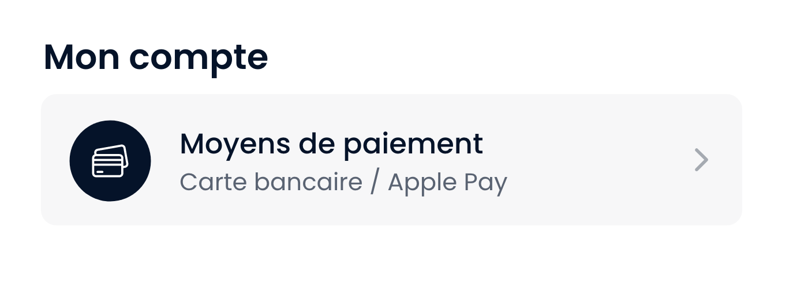

# 1. Configurer les Settings

Tout d'abord, pour configurer le package de settings, merci d'utiliser la "DependciesConfigurations" suivantes : `kosmos-settings` avec un objet `Dart KosmosSettingsConfig()`.

Le package de settings utilise 2 grandes fonctionnalités :

- Un système de `Section` (Groupement de settings cellule)
- Un système de `Node` (Une pour chaque cellule)

Vous pouvez donc créer plusieurs sections de nodes afin de créer votre page de settings :

```Dart
"kosmos-settings": KosmosSettingsConfig(
    settingsSection: <CelluleSection>[
        /// Section "Mon Compte"
        CelluleSection(
            title: (_, __) => "package.settings.section-title.personnal-data".tr(),
            cellules: <CelluleModel>[
                /// Node "Moyens de paiement"
                CelluleModel(
                    tag: "personnal-payment",
                    onTap: (_, __) {},
                    tileBuilder: (_, __) => "package.settings.node.payment.title".tr(),
                    subTitleBuilder: (_, __) => "package.settings.node.payment.subtitle".tr(),
                    prefixSvgPath: "assets/svg/ic_payment.svg",
                ),
            ],
        ),
    ],
),
```

Cette section s'affichera donc de la façon suivante dans l'application :


---

### Caractéristiques d'une cellule

Les `CelluleNode` sont des modèles appartenant au package `Ui-Kosmos`, elles sont donc totalement configurables. Voici une liste des champs que vous pouvez configurer.

```Dart
/// Permet de définir le type de la none, 'action' affichera l'icône d'action en suffix,
/// 'switcher' affichera un 'KosmosSwicth' et 'none' l'aissera la node vierge.
enum CelluleType { action, switcher, none }

class CelluleModel {
  /// Permet de reconnaître la node (le tag doit être unique et est obligatoire).
  final String tag;

  /// Permet de récupérer le titre de la node lors de son build (via BuildContext ou Riverpod Reference)
  final String Function(BuildContext, WidgetRef) tileBuilder;

  /// Permet de récupérer le sous-titre de la node lors de son build (via BuildContext ou Riverpod Reference)
  final String Function(BuildContext, WidgetRef)? subTitleBuilder;

  /// Permet de définir le type de la node (voir 'CelluleType')
  final CelluleType type;

  /// Permet de fournir un svg à afficher dans la bulle de prefix
  final String? prefixSvgPath;

  /// permet de fournir un Widget à afficher dans la bulle de prefix
  final Widget Function(BuildContext, WidgetRef)? prefixBuilder;

  /// Si retourne un 'true', affichera alors une pastille de notification avant le suffix.
  final bool Function(BuildContext, WidgetRef)? showNotifAlert;

  /// Action à effectuer lorsqu'on tap sur la node (uniuement pour les types Action et None)
  /// La fonction est obligatoire si votre node est du type Action
  final void Function(BuildContext, WidgetRef)? onTap;

  /// Action à effecteur lorsqu'on switch la node du switcher.
  /// Attention, la valeur retournée servira à update l'état du 'KosmosSwicth'
  final FutureOr<bool> Function(BuildContext, WidgetRef, bool)? onSwitch;

  /// Permet de définir la valeur initiale du switch
  final bool Function(BuildContext, WidgetRef)? initialSwitchValue;

  /// Permet de définir les sous sections (Voir 2.)
  final CelluleSection? sectionChild;
}
```

Pour configurer votre node, il faudra faire ça directement dans sa déclaration dans la `PackageDependencies` (Voir 1.).

---

# 2. Sous section et sous page

Le système de node permet de configurer directement l'affichage d'une seconde (ou plus). Pour faire plus simple, lorsque vous cliquerez sur cette node (de type Action uniquement), vous ouvrirez automatiquement une autre page avec les nodes enfants.

Pour configurer ces nodes, il faut configurer la variable `sectionChild`:

```Dart
/// Reprenons l'exemple de la node de paiement

/// Node "Moyens de paiement"
CelluleModel(
    tag: "personnal-payment",
    onTap: (_, __) {},
    tileBuilder: (_, __) => "package.settings.node.payment.title".tr(),
    subTitleBuilder: (_, __) => "package.settings.node.payment.subtitle".tr(),
    prefixSvgPath: "assets/svg/ic_payment.svg",
    sectionChild: CelluleSection( /// On réouvre ici une section
        title: (_, __) => "package.settings.section-title.personnal-data".tr(), /// On redéfinie le titre de la section
        /// Ici le titre servira de titre dans la nouvelle page.

        cellules: <CelluleModel>[
            /// On redéfinie les nodes à afficher
            ...
        ],
    ),
),
```

# 3. Exemple de node pré-existante

Vous avez dans votre projet, normalement, un listing des nodes principalement utilisées. Si jamais vous ne les avez pas, vous pouvez regarder dans l'exemple ci-dessous :

```Dart
/// Les nodes d'exemples correspondent à celles présentes dans la maquette Ui-Kosmos-v4.1

settingsSection: <CelluleSection>[
    /// Section "Mon Compte"
    CelluleSection(
    title: (_, __) => "package.settings.section-title.personnal-data".tr(),
    cellules: <CelluleModel>[
        /// Node "Données personnelles" + son image de profil
        CelluleModel(
        tag: "personnal-data",
        tileBuilder: (_, ref) => "${ref.watch(userProvider).user?.firstname ?? ""} ${ref.watch(userProvider).user?.lastname ?? ""}",
        subTitleBuilder: (_, ref) => ref.watch(userProvider).user?.email ?? "",
        onTap: (_, __) {},
        prefixBuilder: (_, ref) => CachedNetworkImage(
            imageUrl: ref.watch(userProvider).user?.profileImage ?? "",
            fit: BoxFit.cover,
            placeholder: (_, __) => Image.asset("assets/images/img_user_profil.png"),
        ),
        ),

        /// Node "Sécurité"
        CelluleModel(
        tag: "personnal-security",
        onTap: (_, __) {},
        tileBuilder: (_, __) => "package.settings.node.security.title".tr(),
        subTitleBuilder: (_, __) => "package.settings.node.security.subtitle".tr(),
        prefixSvgPath: "assets/svg/ic_security.svg",
        sectionChild: CelluleSection(
            title: (_, __) => "package.settings.section-title.security".tr(),
            cellules: [
            /// Node "Changer d'adresse email"
            CelluleModel(
                tag: "security-change-email",
                onTap: (context, __) => AutoRouter.of(context).pushNamed("app/profile/security/email"),
                tileBuilder: (_, __) => "package.settings.node.change-email.title".tr(),
                subTitleBuilder: (_, ref) => ref.watch(userProvider).user?.email ?? "",
            ),

            /// Node "Changer de mot de passe"
            CelluleModel(
                tag: "security-change-password",
                onTap: (context, __) => AutoRouter.of(context).pushNamed("app/profile/security/password"),
                tileBuilder: (_, __) => "package.settings.node.change-password.title".tr(),
                subTitleBuilder: (_, ref) => ref.watch(userProvider).user?.lastPasswordUpdate != null
                    ? "package.settings.node.change-password.subtitle"
                        .tr(namedArgs: {"timeAgo": DateTime.now().difference(ref.watch(userProvider).user!.lastPasswordUpdate!).formatTimeAgo()})
                    : "utils.by-default".tr(),
            ),

            /// Node "Numéro de téléphone"
            CelluleModel(
                tag: "security-phone-number",
                onTap: (context, __) => AutoRouter.of(context).pushNamed("app/profile/security/phone-number"),
                tileBuilder: (_, __) => "package.settings.node.phone-number.title".tr(),
                subTitleBuilder: (_, ref) => ref.watch(userProvider).user?.phone ?? "",
            ),
            ],
        ),
        ),

        /// Node "Moyens de paiement"
        CelluleModel(
        tag: "personnal-payment",
        onTap: (_, __) {},
        tileBuilder: (_, __) => "package.settings.node.payment.title".tr(),
        subTitleBuilder: (_, __) => "package.settings.node.payment.subtitle".tr(),
        prefixSvgPath: "assets/svg/ic_payment.svg",
        ),
    ],
    ),

    /// Section "Paramètres"
    CelluleSection(
    title: (_, __) => "package.settings.section-title.settings".tr(),
    cellules: <CelluleModel>[
        /// Node "Notification Push"
        CelluleModel(
        tag: "settings-push-notif",
        type: CelluleType.switcher,
        tileBuilder: (_, __) => "package.settings.node.push-notif.title".tr(),
        initialSwitchValue: (_, ref) => ref.watch(userProvider).user?.enablePushNotification ?? false,
        onSwitch: (_, __, newVal) async =>
            await NotifPermissionController.setPushNotificationPermission(context, newVal, FirebaseAuth.instance.currentUser!.uid),
        subTitleBuilder: (_, ref) =>
            (ref.watch(userProvider).user?.enablePushNotification ?? false) ? "utils.activate".tr() : "utils.deactivate".tr(),
        prefixSvgPath: "assets/svg/ic_notif.svg",
        ),

        /// Node "Notification Email"
        CelluleModel(
        tag: "settings-email-notif",
        type: CelluleType.switcher,
        tileBuilder: (_, __) => "package.settings.node.email-notif.title".tr(),
        initialSwitchValue: (_, ref) => ref.watch(userProvider).user?.enableEmailNotification ?? false,
        onSwitch: (_, __, newVal) async =>
            await NotifPermissionController.setEmailNotificationPermission(newVal, FirebaseAuth.instance.currentUser!.uid),
        subTitleBuilder: (_, ref) =>
            (ref.watch(userProvider).user?.enableEmailNotification ?? false) ? "utils.activate".tr() : "utils.deactivate".tr(),
        prefixSvgPath: "assets/svg/ic_notif.svg",
        ),
    ],
    ),

    /// Section "Autres"
    CelluleSection(
    title: (_, __) => "package.settings.section-title.other".tr(),
    cellules: <CelluleModel>[
        /// Node "Aide"
        CelluleModel(
        tag: "other-help",
        onTap: (_, __) async {
            final String contactEmail = GetIt.I.isRegistered<AppMetadataConfig>() ? GetIt.I<AppMetadataConfig>().cgvu ?? "" : "";
            await launchUrl(Uri.parse("mailto:$contactEmail?subject=Aide&body="));
        },
        tileBuilder: (_, __) => "package.settings.node.help.title".tr(),
        subTitleBuilder: (_, __) => "package.settings.node.help.subtitle".tr(),
        prefixSvgPath: "assets/svg/help.svg",
        ),

        /// Node "Partager l'app"
        CelluleModel(
        tag: "other-share",
        onTap: (_, __) {}, //TODO share app function
        tileBuilder: (_, __) => "package.settings.node.share.title".tr(),
        subTitleBuilder: (_, __) => "package.settings.node.share.subtitle".tr(),
        prefixSvgPath: "assets/svg/share.svg",
        ),
    ],
    ),

    /// Section "Liens"
    CelluleSection(
    title: (_, __) => "package.settings.section-title.link".tr(),
    cellules: <CelluleModel>[
        /// Node "Politique de confidentialité"
        CelluleModel(
        tag: "link-policy",
        onTap: (context, __) => AutoRouter.of(context).pushNamed("legal-information/privacy-policy"),
        tileBuilder: (_, __) => "package.settings.node.link.privacy-policy".tr(),
        ),

        /// Node "CGVU"
        CelluleModel(
        tag: "link-cgvu",
        onTap: (context, __) => AutoRouter.of(context).pushNamed("legal-information/cgvu"),
        tileBuilder: (_, __) => "package.settings.node.link.cgvu".tr(),
        ),

        /// Node "Mentions légales"
        CelluleModel(
        tag: "link-legale-mention",
        onTap: (context, __) => AutoRouter.of(context).pushNamed("legal-information/legal-mention"),
        tileBuilder: (_, __) => "package.settings.node.link.legal-mention".tr(),
        ),
        
        /// Node "À Propos"
        CelluleModel(
        tag: "link-about",
        onTap: (context, __) => AutoRouter.of(context).pushNamed("legal-information/about"),
        tileBuilder: (_, __) => "package.settings.node.link.about".tr(),
        ),
    ],
    ),

    /// Section "Réseaux sociaux"
    CelluleSection(
    title: (_, __) => "package.settings.section-title.social".tr(),
    cellules: <CelluleModel>[
        /// Node "Notre page Facebook"
        CelluleModel(
        tag: "social-facebook",
        onTap: (context, __) async {
            final String? url = GetIt.I.isRegistered<AppMetadataConfig>() ? GetIt.I<AppMetadataConfig>().facebookUrl : null;
            if (url != null) {
            await launchUrl(Uri.parse(url));
            }
        },
        tileBuilder: (_, __) => "package.settings.node.social.facebook".tr(),
        prefixBuilder: (_, __) => Image.asset("assets/images/img_facebook.png", fit: BoxFit.cover),
        ),

        /// Node "Notre page Instagram"
        CelluleModel(
        tag: "social-instagram",
        onTap: (context, __) async {
            final String? url = GetIt.I.isRegistered<AppMetadataConfig>() ? GetIt.I<AppMetadataConfig>().instagramUrl : null;
            if (url != null) {
            await launchUrl(Uri.parse(url));
            }
        },
        tileBuilder: (_, __) => "package.settings.node.social.instagram".tr(),
        prefixBuilder: (_, __) => Image.asset("assets/images/img_instagram.png", fit: BoxFit.cover),
        ),

        /// Node "Notre page twitter"
        CelluleModel(
        tag: "social-twitter",
        onTap: (context, __) async {
            final String? url = GetIt.I.isRegistered<AppMetadataConfig>() ? GetIt.I<AppMetadataConfig>().twitterUrl : null;
            if (url != null) {
            await launchUrl(Uri.parse(url));
            }
        },
        tileBuilder: (_, __) => "package.settings.node.social.twitter".tr(),
        prefixBuilder: (_, __) => Image.asset("assets/images/img_twitter.png", fit: BoxFit.cover),
        ),

        /// Node "Notre page linkedin"
        CelluleModel(
        tag: "social-linkedin",
        onTap: (context, __) async {
            final String? url = GetIt.I.isRegistered<AppMetadataConfig>() ? GetIt.I<AppMetadataConfig>().linkedinUrl : null;
            if (url != null) {
            await launchUrl(Uri.parse(url));
            }
        },
        tileBuilder: (_, __) => "package.settings.node.social.linkedin".tr(),
        prefixBuilder: (_, __) => Image.asset("assets/images/img_linkedin.png", fit: BoxFit.cover),
        ),

        /// Node "Notre page snapchat"
        CelluleModel(
        tag: "social-snapchat",
        onTap: (context, __) async {
            final String? url = GetIt.I.isRegistered<AppMetadataConfig>() ? GetIt.I<AppMetadataConfig>().snapchatUrl : null;
            if (url != null) {
            await launchUrl(Uri.parse(url));
            }
        },
        tileBuilder: (_, __) => "package.settings.node.social.snapchat".tr(),
        prefixBuilder: (_, __) => Image.asset("assets/images/img_snapchat.png", fit: BoxFit.cover),
        ),
    ],
    ),
],
```

Vous pouvez customiser l'esthétique des nodes via le thème "settings_cellule" avec un objet `SettingsCelluleThemeData`.
Vous pouvez customiser l'exthétique de la page de settings via le thème "kosmos-settings" avec un objet `KosmosSettingsThemeData`.

-------

# 4. Configurer le Header de la page Settings

Le header ci-dessous est intégralement configurable.


Pour le configurer, vous devez utiliser la configuration 'kosmos-settings' (voir 1.). Voici une liste des champs configurables:

```Dart
class KosmosSettingsConfig extends PackageConfig {
  /// Affiche la photo de profil dans les settings
  /// Par défaut, ```true```.
  final bool showProfilImage;

  /// Permet de modifier la photo de profil dans les settings
  /// Par défaut, ```true```.
  final bool canModifyProfilImage;

  /// Permet de choisir l'emplacement du bouton de mofication de la photo de profil
  /// Par défaut, ```bottomRight```.
  final ProfilImagePosition profilImagePosition;

  /// Affiche le nom complet dans les settings
  /// Par défaut, ```true```.
  final bool showFullName;

  /// Affiche l'email dans les settings
  /// Par défaut, ```true```.
  final bool showEmail;

  /// Affiche les informations de l'utilisateur dans les settings
  /// Par défaut, ```true```.
  final bool showProfilInfo;

  /// Liste des sections de paramètres
  final List<CelluleSection> settingsSection;

  /// Affiche ou non la ligne "Éditer par Kosmos Digital"
  /// Par défaut, ```true```.
  final bool showKosmosDigitalLine;

  /// Permet de configurer son propre [VoidCallback] pour le bouton
  /// de modification de la photo de profil.
  /// Par défaut : ```null```.
  final VoidCallback? onModifyProfilButtonPressed;

  KosmosSettingsConfig({
    this.showProfilImage = true,
    this.canModifyProfilImage = true,
    this.profilImagePosition = ProfilImagePosition.bottomRight,
    this.showFullName = true,
    this.showEmail = true,
    this.showProfilInfo = true,
    this.settingsSection = const [],
    this.showKosmosDigitalLine = true,
    this.onModifyProfilButtonPressed,
  }) : super("Kosmos-Settings");
}
```